# Post-contenido — Unidad 9: Seguridad en Aplicaciones Web

## Descripción
Repositorio del laboratorio de la Unidad 9 de Programación Web. Contiene un único proyecto Maven Spring Boot
(`seguridad-web/`) con dos mecanismos de autenticación coexistiendo:
sesión (Spring Security form-login) para las vistas Thymeleaf, y
JWT stateless para la API REST bajo `/api/**`.

**Tecnologías:** Java 17, Spring Boot 3.2.12, Spring Security 6.2, Spring Data JPA, Thymeleaf
(+ thymeleaf-extras-springsecurity6), MySQL 8, jjwt 0.12.5.

**Dominio:** `Usuario` (rol `ROLE_ADMIN` o `ROLE_USER`) y `Tarea`. Cada usuario crea y
administra sus tareas; un ADMIN ve y administra todas.

## Estructura del proyecto
```
cardenas-post1-u9/
├── README.md
├── capturas/
└── seguridad-web/
    ├── pom.xml
    └── src/main/
        ├── java/com/universidad/seguridad/
        │   ├── SeguridadApplication.java
        │   ├── config/      SecurityConfig.java        (apiFilterChain @Order(1) + webFilterChain @Order(2))
        │   ├── controller/  AuthController, TareaController          (vistas, sesión)
        │   │                ApiAuthController, ApiTareaController, ApiAdminController  (API, JWT)
        │   ├── dto/         TareaDTO, UsuarioDTO       (respuestas de la API sin datos sensibles)
        │   ├── model/       Usuario, Tarea
        │   ├── repository/  UsuarioRepository, TareaRepository  (@Query parametrizado)
        │   ├── security/    JwtUtil, JwtAuthFilter
        │   └── service/     UsuarioService, TareaService, UsuarioDetailsService
        └── resources/
            ├── application.properties
            ├── static/css/estilos.css
            └── templates/   auth/login, auth/registro, dashboard, admin/panel, tareas/lista, error/403
```

## Parte 1 — Login con Sesión, BCrypt, Roles y Mitigación Activa
`SecurityConfig` define `webFilterChain` (`@Order(2)`, `securityMatcher("/**")`) con form-login,
`BCryptPasswordEncoder(12)`, `UserDetailsService` contra MySQL y autorización por rol tanto en
`HttpSecurity` (`/admin/**` solo ADMIN) como con `@PreAuthorize` en los servicios. Se demuestra
activamente la mitigación de XSS contrastando `th:text` (seguro) con `th:utext` (inseguro) sobre el
mismo campo, y la de SQL Injection contrastando `@Query` parametrizado con una consulta concatenada
documentada solo en comentario.

| Ruta | Acceso | Descripción |
|---|---|---|
| `GET/POST /login` | público | Formulario de login (POST procesado por Spring Security) |
| `GET/POST /registro` | público | Registro: la contraseña se guarda con BCrypt y el rol siempre es `ROLE_USER` |
| `GET /dashboard` | autenticado | Saludo con el nombre del usuario (`th:text`) y enlace al panel solo para ADMIN |
| `GET /tareas?q=` | autenticado | Tareas propias (USER) o todas (ADMIN) y buscador por título |
| `POST /tareas`, `/tareas/{id}/estado`, `/tareas/{id}/eliminar` | propietario o ADMIN | Crear, completar y eliminar |
| `GET /admin` | solo ADMIN | Lista de usuarios |
| `POST /logout` | autenticado | Cierre de sesión (requiere token CSRF) |

### Verificaciones realizadas
| Prueba | Resultado |
|---|---|
| `/dashboard` sin sesión | 302 → `/login` |
| Contraseñas en MySQL | Hash BCrypt `$2a$12$...` (ver captura) |
| USER entra a `/admin` | 403 |
| ADMIN entra a `/admin` | 200 con la lista de usuarios |
| Nombre `<script>alert("XSS")</script>` con `th:text` | Se muestra como texto, no se ejecuta |
| Mismo nombre con `th:utext` (prueba temporal, revertida) | El navegador ejecuta el script: aparece la alerta "XSS" |
| Búsqueda `' OR '1'='1` | 0 resultados: el texto se trata como literal |
| `POST /logout` sin token CSRF | 403 y la sesión sigue activa |
| Logout desde el botón (token incluido por Thymeleaf) | 302 → `/login?logout` |
| USER intenta eliminar una tarea de otro usuario | 403, la tarea no se borra |
| Registro con `rol=ROLE_ADMIN&id=1` en el POST | Se crea un usuario nuevo con `ROLE_USER`; el ADMIN no se modifica |

**SQL Injection — qué habría pasado con la consulta concatenada.** La versión insegura comentada en
`TareaRepository` arma el SQL pegando el texto del usuario:
`SELECT * FROM tareas WHERE titulo LIKE '%' OR '1'='1%'`. La condición `'1'='1'` siempre es verdadera,
así que la consulta habría devuelto **todas las tareas de todos los usuarios** sin filtrar por título.
Con `@Query` y `:texto`, JPA envía el valor como parámetro de un `PreparedStatement` y la base busca
literalmente el título `' OR '1'='1`, que no existe.

## Parte 2 — API REST Stateless Protegida con JWT
`SecurityConfig` agrega `apiFilterChain` (`@Order(1)`, `securityMatcher("/api/**")`), stateless
(`SessionCreationPolicy.STATELESS`), con CSRF desactivado SOLO en esta cadena porque no depende de
cookies. `JwtUtil` genera y valida el token (firma HMAC + expiración de 1 hora); `JwtAuthFilter`
(`OncePerRequestFilter`) lo valida en cada petición a `/api/**` y puebla el `SecurityContext`
manualmente, sin consultar la base de datos en cada request.

| Método | Ruta | Acceso | Respuesta |
|---|---|---|---|
| POST | `/api/auth/login` | público | 200 `{token, email, rol}`; 401 si las credenciales son incorrectas |
| GET | `/api/tareas` | token válido | 200 con las tareas del usuario del token; 401 sin token o con token inválido/expirado |
| POST | `/api/tareas` | token válido | 201 con la tarea creada (sin token CSRF) |
| GET | `/api/admin/usuarios` | token con `ROLE_ADMIN` | 200 para ADMIN; 403 para USER |

### Verificaciones realizadas
| Prueba | Resultado |
|---|---|
| Login con credenciales del ADMIN | 200 con token |
| Login con contraseña incorrecta | 401, sin token |
| `GET /api/tareas` con `Authorization: Bearer <token>` | 200 |
| Sin header `Authorization` | 401 |
| Token con un carácter de la firma cambiado | 401 |
| Token `eyJhbGciOiJIUzI1NiJ9.token.modificado` | 401 |
| Token expirado (emitido con expiración de 3 s) | 401 |
| Token de USER en `/api/admin/usuarios` | 403 |
| `GET /api/tareas` solo con la cookie de sesión del navegador | 401: la API no acepta la sesión |
| `/dashboard` con sesión mientras se usa la API | 200: ambos mecanismos funcionan a la vez |

### Ejemplo de uso
```bash
# 1. Login: obtener el token
curl -X POST http://localhost:8080/api/auth/login -H "Content-Type: application/json" \
     -d '{"email":"admin@universidad.edu","contrasenia":"admin123"}'

# 2. Petición autenticada con el token
curl http://localhost:8080/api/tareas -H "Authorization: Bearer <token>"
```

## Por qué dos mecanismos en el mismo proyecto
Las vistas Thymeleaf sirven a un navegador con cookie de sesión: CSRF debe seguir activo ahí,
porque el navegador adjunta esa cookie automáticamente incluso en peticiones originadas por otro
sitio. La API sirve a clientes sin cookies (app móvil, SPA externa, integración de terceros): un
token autocontenido en el header `Authorization` resuelve ese caso sin depender de estado en el
servidor, y como un formulario de otro sitio no puede fijar ese header, desactivar CSRF en esa
cadena es seguro. Ningún mecanismo reemplaza al otro; cada uno cubre un tipo de cliente distinto
del mismo sistema, y ambos validan las credenciales con el mismo `UserDetailsService` y BCrypt.

## Decisiones de diseño
- **Dos `SecurityFilterChain` con `@Order` explícito:** la de `/api/**` (`@Order(1)`) se evalúa antes
  que la de `/**` (`@Order(2)`); sin ese orden, una petición a la API podría caer en el form-login.
- **401 en la API:** se configura `HttpStatusEntryPoint(UNAUTHORIZED)` en `apiFilterChain`. Sin él,
  Spring Security responde 403 a una petición sin token, porque esa cadena no tiene form-login.
- **El filtro JWT no rechaza peticiones:** si el token falta o es inválido simplemente no autentica, y
  `authorizeHttpRequests` decide. Así las reglas de acceso viven en un solo lugar.
- **`JwtAuthFilter` solo dentro de `apiFilterChain`:** al ser `@Component`, Spring Boot lo registraría
  como filtro de servlet para todas las rutas; un `FilterRegistrationBean` deshabilitado lo evita.
- **`AuthenticationManager` como bean:** Spring Boot no lo expone por defecto; se declara con el mismo
  `DaoAuthenticationProvider` de la Parte 1 para que `/api/auth/login` valide igual que el form-login.
- **Clave JWT fuera del código:** `JwtUtil` recibe la clave desde `application.properties`
  (`jwt.secret=${JWT_SECRET:...}`), que la toma de la variable de entorno `JWT_SECRET`.
- **DTOs en la API:** se devuelven `TareaDTO`/`UsuarioDTO` en vez de las entidades, porque serializar
  `Tarea` incluiría al propietario con el hash de su contraseña.
- **Autorización por propietario:** `@PreAuthorize("hasRole('ADMIN') or #email == authentication.name")`
  compara con el correo autenticado, que existe tanto en la sesión como en el JWT. La búsqueda de un
  USER se limita a sus propias tareas, y modificar o borrar una tarea ajena responde 403.
- **Registro sin *mass assignment*:** `UsuarioService.registrar` fija `id`, `rol` y `activo` en el
  servidor; un POST manipulado no puede crear un ADMIN ni sobrescribir otro usuario.
- **XSS:** todos los datos de usuario se muestran con `th:text`. `th:utext` solo se activó
  temporalmente para la prueba y queda únicamente como comentario en `dashboard.html`.
- **Dominio pequeño (Usuario, Tarea):** la unidad evalúa la capa de seguridad, no el modelado.

## Nota de seguridad para producción
A diferencia del ejemplo de la guía, la clave HMAC del JWT no está escrita en `JwtUtil`: se lee de `application.properties`, que
la toma de la variable de entorno `JWT_SECRET`. El valor por defecto de `application.properties`
existe solo para ejecutar el laboratorio sin configuración adicional; en producción se debe definir
`JWT_SECRET` (mínimo 32 caracteres) o usar un gestor de secretos, porque cualquiera con acceso a la
clave podría firmar tokens válidos. Lo mismo aplica a `DB_USERNAME`/`DB_PASSWORD`.

## Cómo compilar y ejecutar
1. Clonar el repositorio: `git clone https://github.com/Moisex006/cardenas-post1-u9.git`
2. Tener MySQL 8 en ejecución (por ejemplo `docker run -d --name mysql-seguridad -p 3306:3306 -e MYSQL_ROOT_PASSWORD=root mysql:8`)
   y crear la base de datos y el usuario:
   ```sql
   CREATE DATABASE seguridad_db CHARACTER SET utf8mb4 COLLATE utf8mb4_unicode_ci;
   CREATE USER "appuser"@"%" IDENTIFIED BY "apppass";
   GRANT ALL PRIVILEGES ON seguridad_db.* TO "appuser"@"%";
   FLUSH PRIVILEGES;
   ```
3. Revisar `seguridad-web/src/main/resources/application.properties` (o definir las variables de
   entorno `DB_USERNAME`, `DB_PASSWORD` y `JWT_SECRET`).
4. Ejecutar `./mvnw spring-boot:run` dentro de `seguridad-web/` (Hibernate crea las tablas).
5. Insertar el usuario ADMIN (contraseña `admin123`, hash generado con `BCryptPasswordEncoder(12)`):
   ```sql
   INSERT INTO usuarios (nombre, email, contrasenia, rol, activo)
   VALUES ('Administrador', 'admin@universidad.edu',
           '$2a$12$PbFbcpwxYYb/ZK/G5Vd7ou98Y3FTMP5xVa0JuQPWkReW60gMCjj7i', 'ROLE_ADMIN', 1);
   ```
6. Vistas web: http://localhost:8080/login
7. API: `POST http://localhost:8080/api/auth/login`

## Capturas de pantalla
Las capturas de comandos muestran la salida real de `curl` y `mysql` ejecutados contra la aplicación;
en el texto del comando, el token y la cookie aparecen abreviados para que quepan en la imagen.

### Parte 1 — Sesión
Formulario de login:

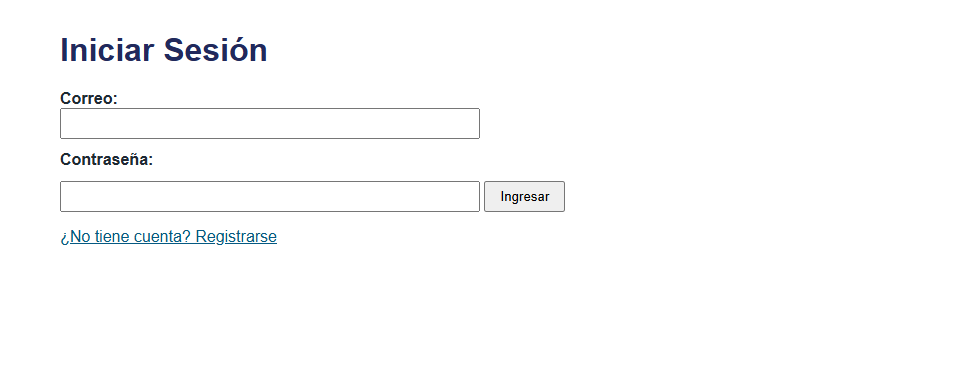

Login con credenciales incorrectas:

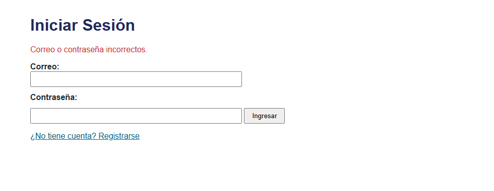

Contraseñas guardadas con BCrypt en MySQL:

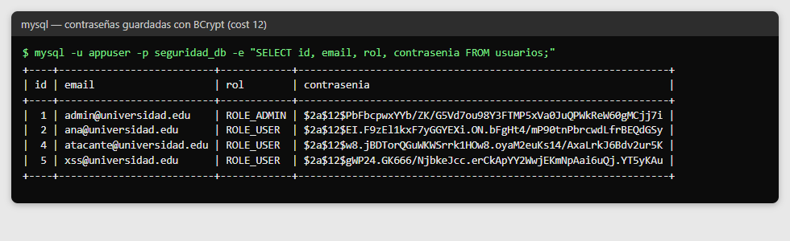

Dashboard con `th:text` seguro (el payload de XSS se muestra como texto):

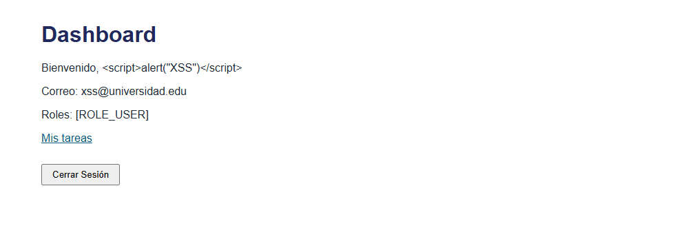

XSS ejecutado con `th:utext` (prueba temporal, revertida antes del commit):

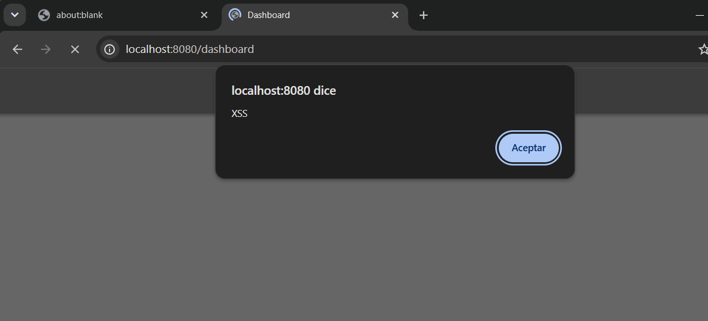

Dashboard del ADMIN (con enlace al panel) y panel de administración:

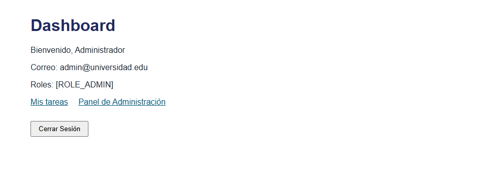
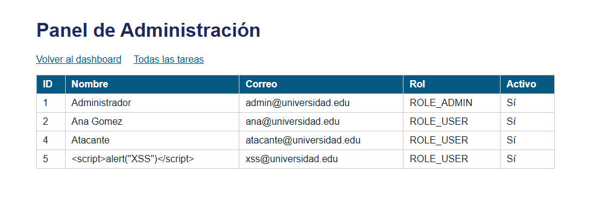

USER intentando entrar a `/admin` (403):

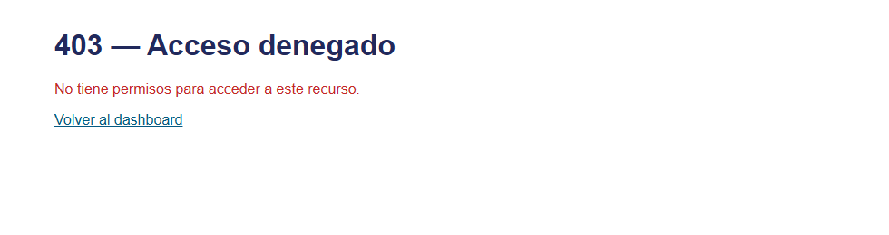

Búsqueda normal y búsqueda con `' OR '1'='1` (`@Query` parametrizado):

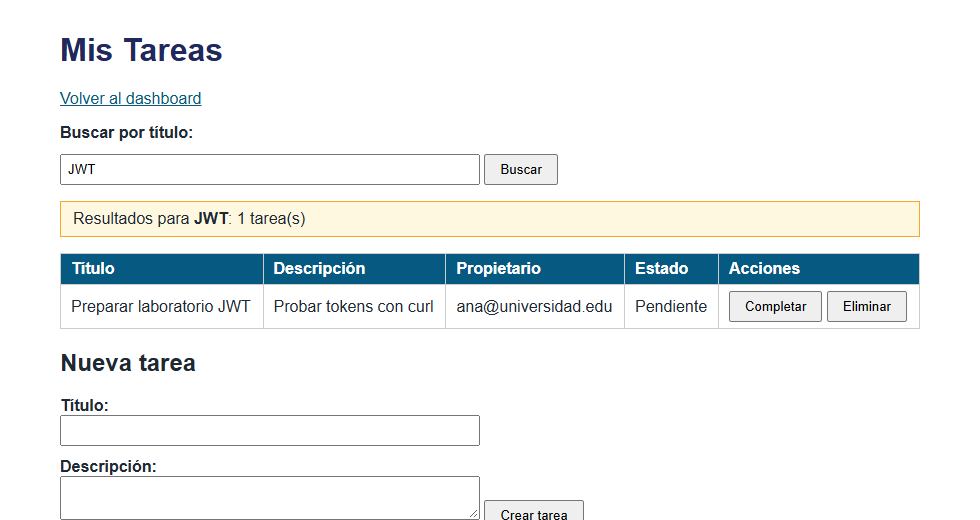
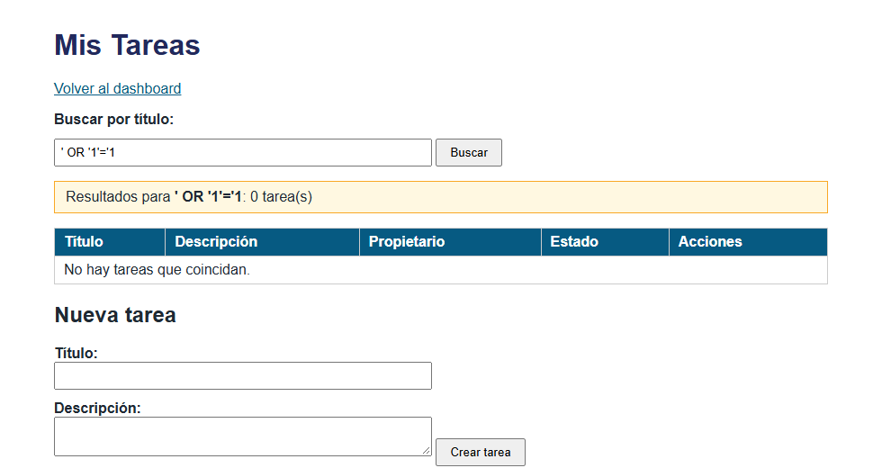

Todas las tareas vistas por el ADMIN:

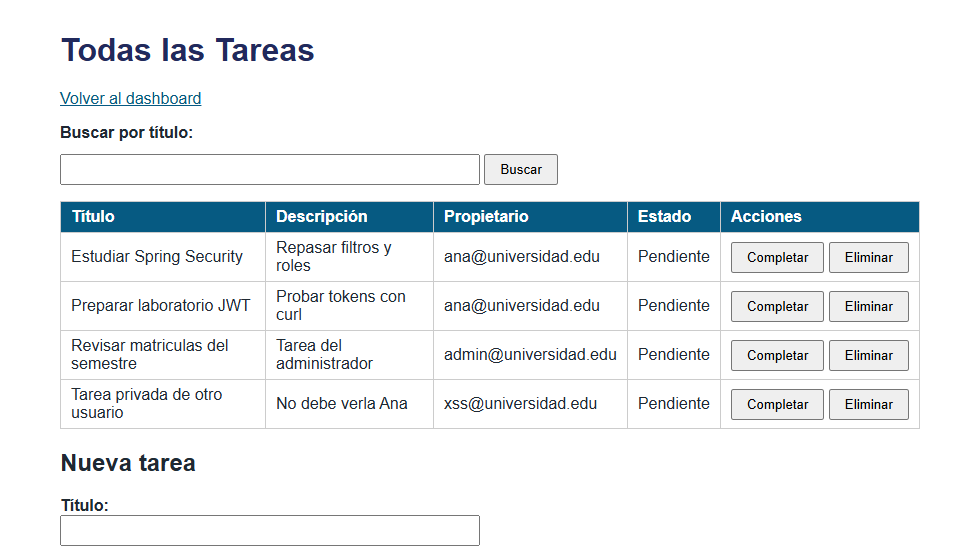

CSRF: `POST /logout` sin token rechazado (403) y logout normal desde el botón:

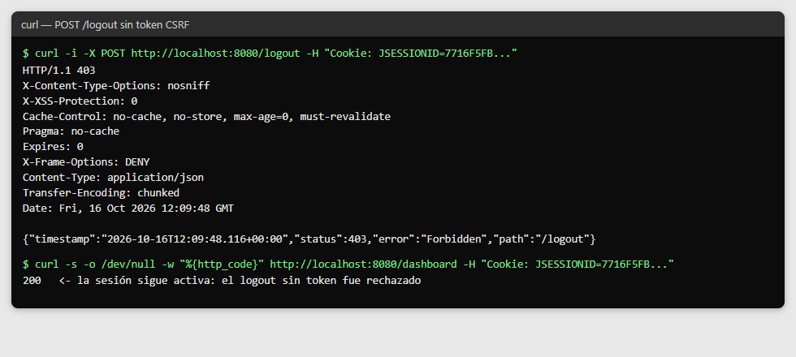
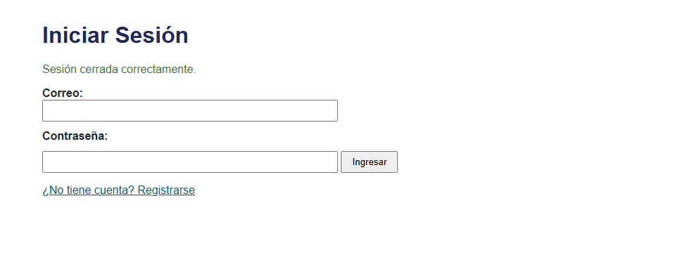

### Parte 2 — JWT
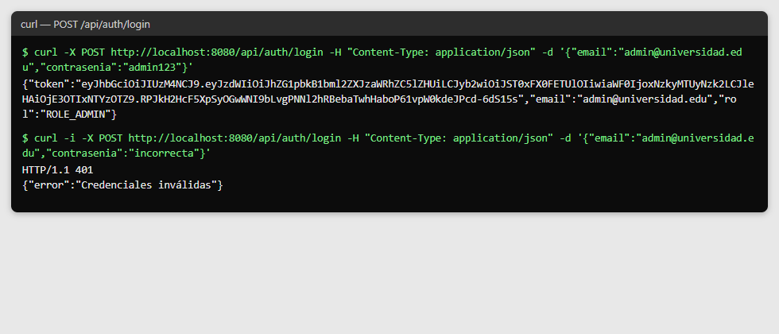
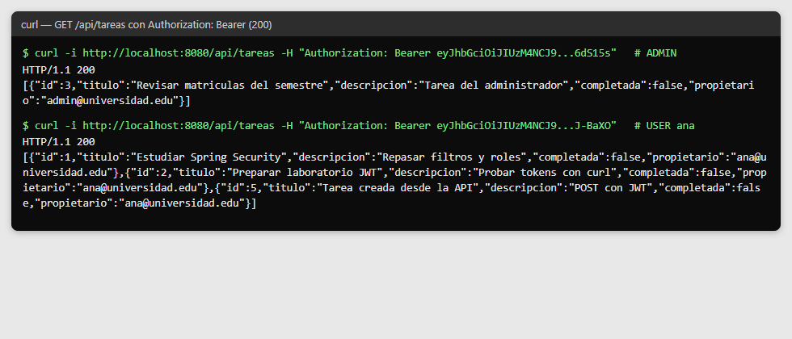
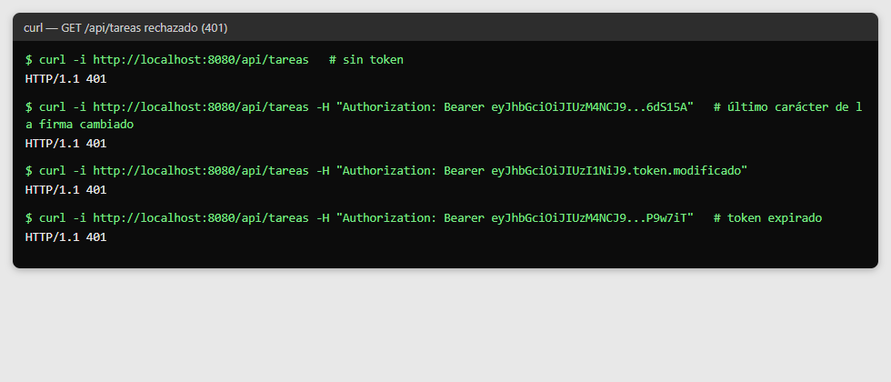
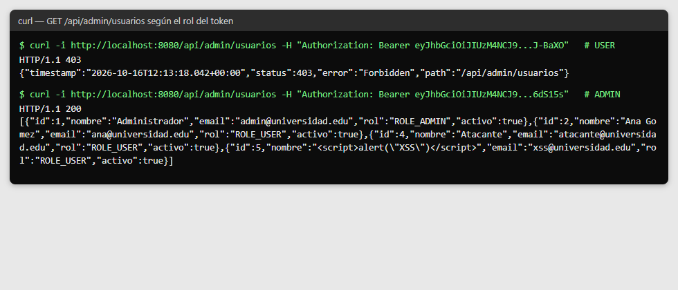

### Sesión y JWT funcionando al mismo tiempo

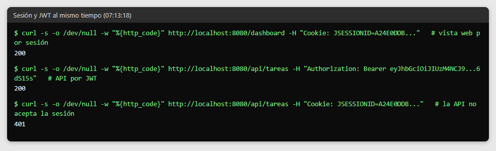
